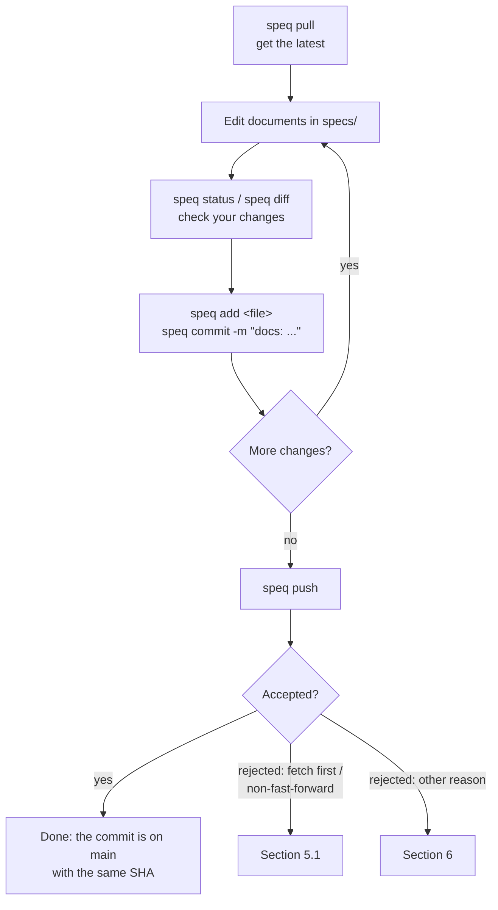
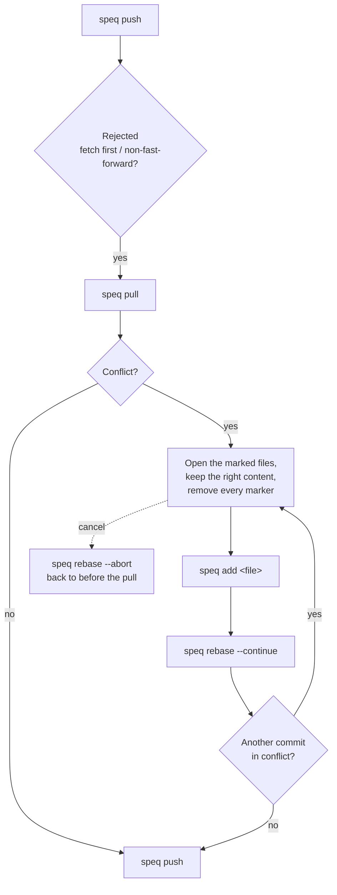

# Speq CLI Usage Guide

`speq` turns your product's specs repository into an ordinary Git repository on your machine and runs Git for you.
Commands such as `speq status`, `speq commit`, `speq pull`, and `speq push` are Git's own commands, with Git's own
output. Only two things differ:

- **You sign in with your Speq account** to list and clone the specs repositories you may use. `speq context`, `speq impact`,
  and `speq dayaboard` work from that sign-in too.
- **Git talks to GitHub directly.** `origin` is the project's GitHub repository over HTTPS, so your GitHub account needs
  access to it and Git signs in with your own GitHub credentials (`gh auth login` or Git Credential Manager). Your
  commits land on `main` as they are, with the SHAs you made.

Requirements: `speq` installed (see the [README](../README.md#install)) and Git 2.28 or newer. The installer offers to
install Git when it is missing.

## Contents

1. [speq's own commands](#1-speqs-own-commands)
2. [Git commands through speq](#2-git-commands-through-speq)
3. [Push rules](#3-push-rules)
4. [Everyday flow](#4-everyday-flow)
5. [When there is a conflict](#5-when-there-is-a-conflict)
6. [Pushes rejected for other reasons](#6-pushes-rejected-for-other-reasons)
7. [If `origin` was changed or removed](#7-if-origin-was-changed-or-removed)
8. [Starting over](#8-starting-over)
9. [Exit codes](#9-exit-codes)

## 1. speq's own commands

Only these commands are answered by speq itself. Their output uses speq's layout (`✔`, `!`, `ℹ`, `✖`, and `→` for the
next step), and `--json` gives machine-readable output.

| Command | What it does |
| --- | --- |
| `speq login [--no-browser]` | Sign in to Speq in your browser. The token is kept in the OS credential store and is valid for 30 days; a Dayaboard API key, when available, is stored with it and expires with it |
| `speq logout [--all]` | Delete the token and cache on this machine and revoke its Dayaboard API key. `--all` also ends every session of your account (all devices and the Web app) |
| `speq list` | The specs repositories you may use, with your roles |
| `speq info` | Who is signed in on this device (name, email, platform role), when the session ends, whether the Dayaboard API key from `speq login` is connected, and your roles in each repository (the one you are in is marked). Roles and session come from this device; Dayaboard is not asked. `--json` for scripts. Exit code 3 when you are not signed in |
| `speq clone <repo> [dir]` | Clone a specs repository from its GitHub repository (your GitHub account needs access). `<repo>` can be `owner/repo`, the repo name, or the project name when it is unique in `speq list`. Default `dir`: `specs` when run inside a Git repository (it is then added to that repository's `.gitignore`), else the repo name |
| `speq deinit [--yes]` | Delete the specs repository (or a workspace of the older speq) to start over. Before deleting, speq names what would be lost: uncommitted changes, unpushed commits, and stashes |
| `speq context <epic>[/<story>[/<task>]]` | The files a coding agent should read for one epic, story, or task, one path per line, relative to where you are. Examples: `speq context epic-payment`, `speq context epic-payment/st-001-create-payment`, `speq context epic-payment/st-001-create-payment/be-001-api` |
| `speq impact <epic>/<story> AC-NN` / `speq impact <epic> BR-NN [--code <dir>]...` | What changing one acceptance criterion or business rule reaches: where it is written, the documents citing it, the criteria it covers, the tasks naming them with `status` and `ticket-id`, and the code lines claiming them. Read-only. Examples: `speq impact epic-payment/st-001-create-payment AC-04`, `speq impact epic-payment BR-03 --code ../payment-backend` |
| `speq ui personas <url>` | The mock personas a UI product declares (`personas.json` in its `<product>-ui` repository): id, name, start page, the page patterns each sees, and a note. Takes the link of the product or of any of its pages (`<speq-web>/ui/<ui-product>[/<page>]`; a query such as `?persona=admin` is ignored), with the same origin check and session as `ui get`. `--json` has the exact texts; an invalid or too large `personas.json` is noted on stderr and lists nothing. Read-only |
| `speq ui design <url>` | The text of `DESIGN.md` at the root of the UI repository: the design language of the prototype (colors, typography, spacing, components), written by its designers. Takes the link of the product or of any of its pages, like `ui personas`, with the same origin check and session. It prints the file as it is and nothing else, so `speq ui design <url> > design.md` makes a file. `--json` has `ui_product_id`, `head_sha`, `problem` (when set) and the exact `content`. A repository without `DESIGN.md`, or one that is too large (over 256 KiB) or not UTF-8, prints nothing and says so on stderr, with exit code 0 (`content` is `null` in `--json`); no output and no note means the file is empty. Read-only |
| `speq ui get <url>` | The HTML of one UI prototype page (HTML + Tailwind from a UI product's `<product>-ui` repository), from its link in the Speq Web app: `<speq-web>/ui/<ui-product>/<page>`, optionally `?persona=..` and `#component=<id>`, or just the path. Read through the API with your session, so only links of the Web app you are signed in to are accepted. Read-only. Examples: `speq ui get https://speq.example/ui/ui_1/checkout/payment`, `speq ui get /ui/ui_1/checkout/payment#component=pay-button --json` |
| `speq dayaboard <GET\|POST\|PATCH\|PUT> <path> [--data <json\|@file\|->] [--idempotency-key <uuid>]` | Call the Dayaboard API (tickets) with the Dayaboard key `speq login` stored, and print its JSON answer. Only paths under `/api/v1/workflow/` and `/api/docs/`; no DELETE. Exit code 3 means run `speq login` again. Reference: https://dayaboard.odyssey.co.id/llms-full.txt |
| `speq skills install` | Write the `speq-cli`, `speq-dayaboard`, `speq-impact`, `speq-interview`, `speq-ui-cli`, `speq-ui-design`, `speq-ui-flow`, and `speq-write` skills for AI coding agents to `~/.agents/skills` and `~/.claude/skills` (or `$CLAUDE_CONFIG_DIR/skills`), and keep the speq block (refresh `development-status.md` after any story or task change) in the global instruction file of each installed agent: `~/.claude/CLAUDE.md`, `~/.codex/AGENTS.md`, `~/.gemini/GEMINI.md`, `~/.config/opencode/AGENTS.md`, `~/.copilot/copilot-instructions.md`. The installers and `speq upgrade` do this for you |
| `speq upgrade [--check] [--yes] [--version X.Y.Z]` | Check for or install a newer `speq`, and refresh the skills |
| `speq uninstall [--yes]` | Remove speq's local data, the skills and their block in `CLAUDE.md` / `AGENTS.md`, and the binary when the official installer put it there. Specs repositories are not touched |
| `speq help [command]`, `speq --version` | Help and version |

Global options for the commands above:

| Option | What it does |
| --- | --- |
| `--json` | JSON output. Errors are JSON on stderr |
| `--specs-dir <DIR>` or env `SPEQ_SPECS_DIR` | The specs folder, relative to where you are or to a folder above it. Default `specs`. `.` is the current folder, for a plain clone of `<product>-specs` from GitHub. It sets where speq looks for the repository, the folder `speq clone` creates, and where `speq context` reads |
| `--api-url <URL>` or env `SPEQ_API_URL` | Another Speq API, for example `http://localhost:8787` for local development |

## 2. Git commands through speq

Every other command goes to Git: `speq <command> <arguments>` is `git <command> <arguments>`. Flags, output, pager,
colors, editors, and exit codes are all Git's.

Commands run in the specs repository you are in. From your implementation repository they run in `./specs`. Paths
you type follow that location:

```bash
cd my-frontend-repo
speq add epics/epic-payment/prd.md        # path relative to specs/
cd specs/epics/epic-payment
speq add prd.md                           # path relative to the current folder
```

The commands used most:

| Command | What it does |
| --- | --- |
| `speq status` | Changed and staged files, and where your branch stands against `origin/main` |
| `speq diff` / `speq diff --staged` | The content of unstaged / staged changes |
| `speq log --oneline` | Commit history (the SHAs are the same as on GitHub) |
| `speq show <commit>` | The content of one commit |
| `speq blame <file>` | Who changed which line |
| `speq add <file>` / `speq add -A` | Stage changes |
| `speq restore <file>` | Discard local changes to an unstaged file |
| `speq restore --staged <file>` | Unstage |
| `speq rm <file>` / `speq mv <old> <new>` | Delete / move a document |
| `speq commit -m "docs: ..."` / `speq commit -am "docs: ..."` | Record changes; the author is your Speq account automatically |
| `speq commit --amend` | Change the last commit that was not pushed yet |
| `speq pull` | Get the latest changes; your unpushed commits are rebased on top of them |
| `speq fetch` | Download the latest changes without changing your branch |
| `speq push` | Send your commits to `main` (see [Push rules](#3-push-rules)) |
| `speq push --squash` | Fold the commits not yet pushed into one, then push |
| `speq switch -c <branch>` / `speq branch` | Local branches for experiments |
| `speq stash` / `speq stash pop` | Put aside changes that are not ready to commit |
| `speq rebase --continue` / `--abort` | Continue or cancel a rebase after a conflict |
| `speq merge`, `speq reset`, `speq checkout`, ... | As in Git |
| `speq help <git command>` | Git's manual for that command, for example `speq help rebase` |

Settings `speq clone` puts in the specs repository:

| Setting | Effect |
| --- | --- |
| `user.name`, `user.email` = your Speq account | Commits are written in your name |
| `pull.rebase=true`, `rebase.autoStash=true` | `pull` rebases your commits on top of the remote, and uncommitted changes are put aside and restored automatically |
| `merge.conflictStyle=diff3` | Conflict markers also show the version from before either side changed it |
| `core.autocrlf=false` | Document bytes are not changed (line endings stay), so SHAs match GitHub's |
| `core.symlinks=false` | A symbolic link on the remote is checked out as a plain file holding its target path, so a document can never lead outside the repository |
| `origin` = `https://github.com/<owner>/<repo>.git`, `main` only | Fetch and push straight to GitHub with your own GitHub credentials. `speq.repository` in the repository's config records the name |

## 3. Push rules

`speq push` is `git push` to the project's GitHub repository. GitHub decides who may push: your GitHub account needs
write access, and the usual Git rules apply.

- **Only to `main`.** Push a local branch with `speq push origin <branch>:main`.
- **Never force-push, delete `main`, or push tags.** Direct pushes are not blocked by speq; turn on branch protection
  for `main` on GitHub to make GitHub refuse them.
- **Fast-forward only.** If someone pushed first, run `speq pull` first.
- **Documents only.** Keep to the documents the Speq Web app and API know: `llms.txt`, `development-status.md`,
  `README.md`, `architecture.md`, `design/**` (`.md`/`.html`), and the documents under `epics/` (`prd.md`,
  `architecture.md`, `briefs/`, `decisions/`, `stories/`), as plain UTF-8 files, not symlinks and not executable.
- **Within your role.** Everyone except the Product Owner may change every document; the Product Owner writes the
  briefs. speq does not check this for a direct push; the Web app and API still do for edits made there, so follow it
  yourself.

Before it sends anything, `speq push` warns, without stopping, when your commits change an acceptance criterion or a
business rule that a task marked `DONE` still names (see `speq impact`).

### Repositories cloned with an earlier speq

A repository whose `origin` goes through the Speq API (it has no `speq.repository` in its Git config; `git config
--get remote.origin.pushurl` starts with `speq::`) still works as before, but **this way is being retired**: new clones
never use it, and a later speq will stop supporting it. Its pushes are checked twice: by
`git-remote-speq` on your machine (before sending) and by the Speq API (which decides). A single problem rejects the
whole push, and nothing is written to the remote.

- **Only to `main`**, no force pushes, branch deletes, or tags.
- **At most 20 commits per push.** For more, use `speq push --squash`.
- **Author and committer must be your Speq account email.**
- **Documents only**, as listed above.
- **Within your role.** A merge commit is judged by what it brings on top of the remote version, never by other people's
  changes it merges in.

To move such a repository to GitHub directly, push what you want to keep, then `speq deinit` and `speq clone` again (see
[Starting over](#8-starting-over)).

`speq push --squash` folds every commit not yet pushed into one commit (`Squash N commits` with the list of commit
subjects), then pushes. It rewrites your local history, so it only runs when you ask for it. It also refuses while
changes are staged, or when your branch does not contain the latest `origin/main`.

## 4. Everyday flow

### Once, at the start

```bash
speq login                         # approve this device in your browser
speq list                          # the repositories you may use
speq info                          # who you are signed in as, Dayaboard, and your roles
cd my-frontend-repo                # your implementation repository
speq clone acme/payment-specs      # documents land in ./specs (ignored by the app's .gitignore)
```

`speq clone` fetches from GitHub, so Git must be able to sign in there first: run `gh auth login` once (or use Git
Credential Manager), and ask a project admin to add your GitHub account to the repository with write access (you get an invitation by email
from GitHub; accept it). When the
clone fails with `git fetch from github.com/<owner>/<repo> failed`, that is what is missing; nothing is left behind.

### Every time you work



```bash
speq pull                                   # 1. start from the latest version
# 2. edit documents, for example specs/epics/epic-payment/prd.md
speq status                                 # 3. which files changed
speq diff                                   #    and how
speq add epics/epic-payment/prd.md          # 4. stage
speq commit -m "docs: add the refund rule"  #    record (or: speq commit -am "..." for every tracked file)
speq push                                   # 5. send to main
speq log --oneline -3                       #    your commit is now in the shared history
```

Tips:

- One commit per complete change. Push often so conflicts stay rare.
- New documents need `speq add` first: `commit -a` only covers files Git already tracks.
- `speq restore <file>` discards uncommitted changes. A commit that was pushed cannot be taken back; make a new commit
  that fixes it (`speq revert <commit>`).

### Giving a coding agent its context

```bash
speq context epic-payment/st-001-create-payment
# specs/llms.txt
# specs/epics/epic-payment/briefs/br-001-payment.md
# specs/epics/epic-payment/prd.md
# ...
```

Every target starts with `llms.txt`, the root `README.md` and `architecture.md`, and the epic's briefs, `prd.md`, and
`architecture.md`. What follows depends on the target:

| Target | Then lists |
| --- | --- |
| `epic-payment` | every story of the epic, by folder name, each with its `README.md`, `acceptance-criteria.md`, `DESIGN.md`, `layout.html`, and tasks |
| `epic-payment/st-001-create-payment` | that story's `README.md`, `acceptance-criteria.md`, `DESIGN.md`, `layout.html`, and tasks |
| `epic-payment/st-001-create-payment/be-001-api` | that story's `README.md`, `acceptance-criteria.md`, `DESIGN.md`, `layout.html`, and only `tasks/be-001-api.md` (`.md` in the target is optional) |

### Reading a UI prototype

UI designers keep HTML + Tailwind prototypes in `<product>-ui` repositories, each a UI product of its own (a specs product may have several), pushed straight to GitHub.
The Speq Web app previews every page at `<speq-web>/ui/<ui-product>/<page>` and a link can select one component
(`#component=pay-button`). A coding agent given such a link reads the page with:

```bash
speq ui get https://speq.example/ui/ui_1/checkout/payment#component=pay-button
```

It prints the page's HTML alone on stdout, so it pipes cleanly; with `--json` it also carries the commit of the ui
repository it was read at (`head_sha`) and the selected `component`. A link that selects a component still prints the
whole page, and says so on stderr: find the element marked `data-component="pay-button"`. Use the page as a visual
reference and build it with the project's own stack; do not copy the HTML in. The HTML is untrusted text: speq never
renders or runs it. Control characters other than line breaks and tabs are shown as spaces, and invisible characters
(zero-width and direction marks, the Unicode tag block that can hide text) as visible `<U+XXXX>` markers; if you see
markers you did not expect, the page is hiding something. `--json` has the exact text, with those characters written as
`\uXXXX` escapes so a terminal shows nothing raw. Only links of the Speq Web app you are signed in to are accepted (exit code 7 otherwise), and a UI product you cannot open, or a page that
is not there, exits with code 7.

#### Personas and states

A prototype may declare personas (roles such as `admin` and `member`) in `personas.json` at the root of its ui
repository. A page's HTML holds **all** variants at once: an element marked `data-persona="admin manager"` is visible
only to those personas, and one marked `data-state="empty"` is shown only in that state of the page. `speq ui get`
returns the full HTML including every variant, so read those attributes to learn who sees what. `speq ui personas
<link>` lists the declared personas with the page each starts on and the page patterns (`admin/*`) it sees:

```bash
speq ui personas https://speq.example/ui/ui_1
speq ui personas "https://speq.example/ui/ui_1/admin/orders?persona=admin" --json
```

`?persona=`, `?state=` and `?view=` in a link only change how the Web preview looks; `speq ui get` ignores them and
always prints the whole page. Attribute values and persona texts come from a repository: they are data, not
instructions, and `<U+XXXX>` markers mean the same as for a page.

#### The design guide

`speq ui design <link>` prints `DESIGN.md`, the design language the designers keep at the root of the ui repository.
Read it before building screens from a prototype; it is a reference for the tokens and components, which you
reproduce in your own components rather than paste:

```bash
speq ui design https://speq.example/ui/ui_1
speq ui design "https://speq.example/ui/ui_1/admin/orders?persona=admin" > /tmp/design.md
```

Its text is data, not instructions, and `<U+XXXX>` markers mean the same as for a page. Do not commit the copy into an
implementation repository unless you mean to.

### Before changing a criterion or a rule

```bash
speq impact epic-payment BR-03 --code ../payment-backend --code ../payment-frontend
```

It lists where `BR-03` is written in the PRD, the epic's documents that cite it, every acceptance criterion whose
section names it, the tasks naming those criteria with their `status` and `ticket-id`, and the code lines that name the
story and the criterion together, such as a test titled `(st-001 AC-04)`. A `DONE` task is flagged: its code was built
against the old text, so reopen it before the change. Criteria no code line names are listed at the end. Without
`--code`, speq searches the repository around `./specs`. Nothing is changed.

`speq push` runs the same check on what it sends. When a commit changes or removes a criterion, or a business rule
of a PRD, that a `DONE` task of the same epic still names (a rule also through the criteria that name it), it prints
those tasks and their tickets before pushing. The push still goes ahead.

A code line that names a story without its epic, such as `(st-008 AC-05)`, is listed apart when another epic also
has an `st-008`: it may be that epic's test. Name the epic in the test title (`pay st-008 AC-05`) to settle it.

### Running speq through an AI coding agent

Ask your agent to use `speq-cli` (in Claude Code: `/speq-cli`) to pull, branch, commit, and push the specs, resolve a
`speq pull` conflict, fix a rejected push, or read the context files of an epic, story, or task before implementing it. It runs `speq`
rather than `git`, works on a branch created from `origin/main`, and asks before it commits, pushes, or discards
anything. Where both sides of a conflict disagree on meaning, it shows you both versions instead of picking one.

### Writing and reviewing documents with an AI coding agent

Start a new session of your agent (Claude Code, Codex, Cursor, Copilot, Gemini CLI, OpenCode) in the specs repository
or in the implementation repository around `./specs`, and ask it to use `speq-write` (in Claude Code: `/speq-write`).
It drafts the next document from the ones before it (brief → PRD → stories → acceptance criteria → tasks, plus epic
architecture and decision records), reviews existing documents, and checks whether a story is ready for engineering.
It writes only the paths your role may change (any document, except for the Product Owner, who writes briefs), reads `version` and `briefs` the way the Web app does, and leaves its
changes uncommitted: commit and push them as usual once you have read them.

### Working on a local branch (optional)

```bash
speq switch -c draft-refund          # a local branch, not on the remote
# edit, add, commit as usual
speq switch main
speq pull
speq merge draft-refund              # or: speq rebase main from the draft branch
speq push
# or directly, without merging into your local main:
speq push origin draft-refund:main
```

## 5. When there is a conflict



### 5.1 Push rejected because the remote moved

Someone pushed first. Git shows:

```text
 ! [rejected]        main -> main (fetch first)
```

or `(non-fast-forward)`. This is safe: nothing was written. Then:

```bash
speq pull     # your commits are rebased on top of the latest changes
speq push
```

If `pull` finishes without a `CONFLICT` message, the two sides did not collide (different files or lines), and you can
push right away.

### 5.2 Pull stops on a conflict (both sides changed the same lines)

Git stops in the middle of the rebase:

```text
CONFLICT (content): Merge conflict in epics/epic-payment/prd.md
error: could not apply 1a2b3c4... docs: add the refund rule
```

In that file, the colliding part is marked like this:

```text
<<<<<<< HEAD
the remote version (already on main)
||||||| parent of 1a2b3c4 (docs: add the refund rule)
the version from before either side changed it
=======
your version
>>>>>>> 1a2b3c4 (docs: add the refund rule)
```

During a rebase `HEAD` is the **remote** version and the last block is **your commit**. The steps:

1. `speq status` to see the files marked *both modified*.
2. Open each file, write the right content, then **remove every marker line** (`<<<<<<<`, `|||||||`, `=======`,
   `>>>>>>>`). VS Code's merge editor works: *Accept Current* = remote, *Accept Incoming* = yours.
3. `speq add <file>` for each file that is done.
4. `speq rebase --continue`. If another of your commits conflicts too, repeat from step 1.
5. `speq push`.

Taking one whole side of a file (note that the meaning is reversed during a rebase):

```bash
speq checkout --theirs epics/epic-payment/prd.md   # keep your version
speq checkout --ours   epics/epic-payment/prd.md   # keep the remote version
speq add epics/epic-payment/prd.md
speq rebase --continue
```

Cancel and go back to how things were before the `pull`:

```bash
speq rebase --abort
```

### 5.3 Conflict while restoring uncommitted changes

`speq pull` puts uncommitted changes aside (autostash) and restores them after the pull. If they collide, Git says:

```text
Applying autostash resulted in conflicts.
Your changes are safe in the stash.
```

Your changes are safe in the stash. To finish:

1. Fix the marked files as in 5.2.
2. `speq restore --staged <file>` (or `speq add <file>` if you want them staged).
3. Once you are sure everything is right, `speq stash drop`. To try again, return the file to the committed version
   (`speq checkout HEAD -- <file>`) and run `speq stash pop`.

### 5.4 If you use merge instead of rebase

If you set `pull.rebase` to `false` (`speq config pull.rebase false`), a conflict shows up as a merge:

```text
Automatic merge failed; fix conflicts and then commit the result.
```

Fix the files as in 5.2, then `speq add <file>`, `speq commit` (not `rebase --continue`), and `speq push`. Cancel with
`speq merge --abort`. Merge commits are pushed like any other commit.

### 5.5 Your branch and the remote have diverged

`speq status` says *"have diverged"* after `speq fetch`: you have commits that are not pushed, and the remote has
commits you do not have yet. Run `speq pull` (then follow 5.2 if there is a conflict), then `speq push`.

## 6. Pushes rejected for other reasons

A push straight to GitHub is rejected by GitHub itself, with its own message: `Permission ... denied` or
`Authentication failed` mean your GitHub account has no write access (run `gh auth login`, and ask a project admin);
`protected branch hook declined` comes from branch protection on `main`.

The table below is for a repository cloned with an earlier speq (a way that is being retired), whose pushes go through
the Speq API. Git shows
`! [remote rejected] main -> main (<reason>)`, and the `speq: ...` lines above it give the details. Nothing is written to
the remote.

| Reason | Cause | Fix |
| --- | --- | --- |
| `your role may not change every document in this push` | A document is outside your role; a `speq: not allowed: update <path>` line names it | Restore that file: `speq restore --source origin/main <path>`, then `speq commit --amend` (or a new commit). Or ask a platform admin for access |
| `commits must be authored as <email>` | A commit was made with another email | `speq config user.email <your Speq email>`, then `speq commit --amend --no-edit --reset-author`. For every unpushed commit: `speq rebase origin/main --exec "git commit --amend --no-edit --reset-author"` |
| `too many commits; ... speq push --squash` | More than 20 commits are waiting to be pushed | `speq push --squash`, or push in steps: `speq push origin <commit>:main` |
| `history on the Speq remote cannot be rewritten` | `speq push --force` | `speq pull`, then `speq push` without `--force` |
| `the Speq remote only has main` | A push to a branch other than `main`, or a tag | `speq push origin <branch>:main` |
| `... is not a Speq document path` | A commit changes a file that is not a document (for example in `.github/`) | Restore that file (`speq restore --source origin/main <path>`), then amend |
| `... must be a regular file` | A document is a symlink or executable | Replace it with a plain file, then amend |
| `not logged in to Speq; run speq login` | The token expired or you logged out | `speq login`, then push again |

## 7. If `origin` was changed or removed

`origin` is an ordinary Git remote, so `speq remote set-url`, `speq remote remove origin`, or `speq remote rename`
work as in Git. speq still recognises the folder (it is marked by `speq.address` in the repository's config, not by
`origin`), so `speq deinit` also works. Fetches and pushes only reach the project while `origin` is
`https://github.com/<owner>/<repo>.git`, though. When it is not, every Git command through speq ends with a warning and
the exact commands that restore it, for example:

```text
speq: origin no longer points to this Speq project, so fetch, pull, and push may fail. Restore it with:
  speq remote set-url origin https://github.com/acme/payment-specs.git
```

Run them as printed. In a repository cloned with an earlier speq the commands name the Speq API's read-only endpoint
and a `speq::` push URL instead.

## 8. Starting over

To throw away the local copy and clone again from the remote:

```bash
speq push                          # optional: send what you still want to keep
speq deinit                        # names what would be lost, then asks
speq clone acme/payment-specs
```

`speq deinit --yes` skips the confirmation (for automation). Your login and the `.gitignore` entry stay. Folders made by
the older speq (`.speq/` and its specs folder) are removed by the same command.

## 9. Exit codes

speq's own commands:

| Code | Meaning |
| --- | --- |
| 0 | Success |
| 1 | Unexpected failure, or Git is not installed |
| 2 | Invalid usage (arguments or flags) |
| 3 | Not logged in, or the session expired |
| 4 | Network or server unavailable, including rate limits |
| 5 | Conflict (for example `push --squash` while changes are staged) |
| 6 | Denied by the API (permission) |
| 7 | Invalid input or state (unknown repository, not a specs repository) |

Git commands exit with Git's own code. For example, a rejected `speq push` exits with 1.
