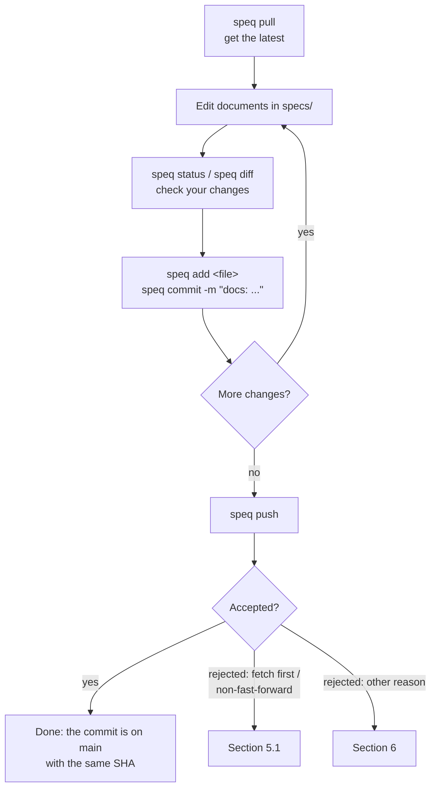
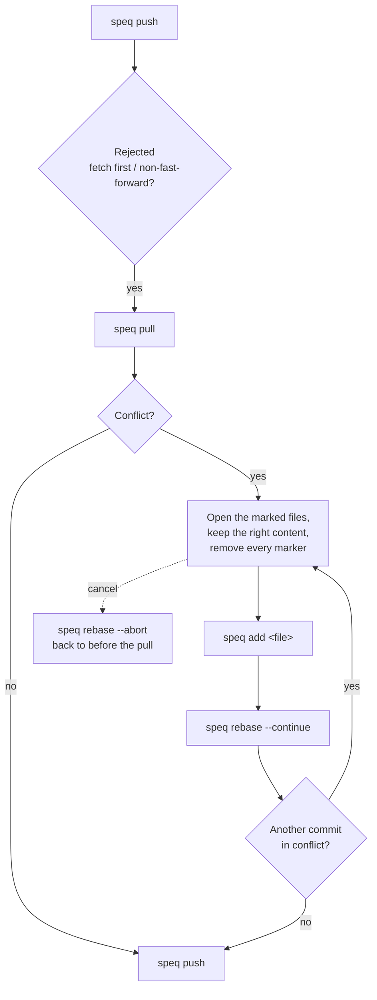

# Speq CLI Usage Guide

`speq` turns your product's specs repository into an ordinary Git repository on your machine and runs Git for you.
Commands such as `speq status`, `speq commit`, `speq pull`, and `speq push` are Git's own commands, with Git's own
output. Only two things differ:

- **You sign in with your Speq account.** You need no GitHub account and no GitHub credentials.
- **Every push is checked by the Speq API** (role, author, document paths) before it lands on `main`. Commits that
  pass land with exactly the same SHA, so your history and GitHub's are the same commits.

Requirements: `speq` installed (see the [README](../README.md#install)) and Git 2.28 or newer. The installer offers to
install Git when it is missing.

## Contents

1. [speq's own commands](#1-speqs-own-commands)
2. [Git commands through speq](#2-git-commands-through-speq)
3. [Push rules](#3-push-rules)
4. [Everyday flow](#4-everyday-flow)
5. [When there is a conflict](#5-when-there-is-a-conflict)
6. [Pushes rejected for other reasons](#6-pushes-rejected-for-other-reasons)
7. [Starting over](#7-starting-over)
8. [Exit codes](#8-exit-codes)

## 1. speq's own commands

Only these commands are answered by speq itself. Their output uses speq's layout (`✔`, `!`, `ℹ`, `✖`, and `→` for the
next step), and `--json` gives machine-readable output.

| Command | What it does |
| --- | --- |
| `speq login [--no-browser]` | Sign in to Speq in your browser. The token is kept in the OS credential store and is valid for 30 days |
| `speq logout [--all]` | Delete the token and cache on this machine. `--all` also ends every session of your account (all devices and the Web app) |
| `speq list` | The specs repositories you may use, with your roles |
| `speq clone <repo> [dir]` | Clone a specs repository as a Git repository wired to Speq. `<repo>` can be `owner/repo`, the repo name, or the project name when it is unique in `speq list`. Default `dir`: `specs` when run inside a Git repository (it is then added to that repository's `.gitignore`), else the repo name |
| `speq deinit [--yes]` | Delete the specs repository (or a workspace of the older speq) to start over. Before deleting, speq names what would be lost: uncommitted changes, unpushed commits, and stashes |
| `speq context <epic>/<story>` | The files a coding agent should read for one story, one path per line, relative to where you are. Example: `speq context epic-payment/st-001-create-payment` |
| `speq upgrade [--check] [--yes] [--version X.Y.Z]` | Check for or install a newer `speq` |
| `speq uninstall [--yes]` | Remove speq's local data, and the binary when the official installer put it there. Specs repositories are not touched |
| `speq help [command]`, `speq --version` | Help and version |

Global options for the commands above:

| Option | What it does |
| --- | --- |
| `--json` | JSON output. Errors are JSON on stderr |
| `--api-url <URL>` or env `SPEQ_API_URL` | Another Speq API, for example `http://localhost:8787` for local development |

## 2. Git commands through speq

Every other command goes to Git: `speq <command> <arguments>` is `git <command> <arguments>`. Flags, output, pager,
colors, editors, and exit codes are all Git's.

Commands run in the specs repository you are in. From your implementation repository they run in `./specs`. Paths
you type follow that location:

```bash
cd my-frontend-repo
speq add epics/epic-payment/prd.md        # path relative to specs/
cd specs/epics/epic-payment
speq add prd.md                           # path relative to the current folder
```

The commands used most:

| Command | What it does |
| --- | --- |
| `speq status` | Changed and staged files, and where your branch stands against `origin/main` |
| `speq diff` / `speq diff --staged` | The content of unstaged / staged changes |
| `speq log --oneline` | Commit history (the SHAs are the same as on GitHub) |
| `speq show <commit>` | The content of one commit |
| `speq blame <file>` | Who changed which line |
| `speq add <file>` / `speq add -A` | Stage changes |
| `speq restore <file>` | Discard local changes to an unstaged file |
| `speq restore --staged <file>` | Unstage |
| `speq rm <file>` / `speq mv <old> <new>` | Delete / move a document |
| `speq commit -m "docs: ..."` / `speq commit -am "docs: ..."` | Record changes; the author is your Speq account automatically |
| `speq commit --amend` | Change the last commit that was not pushed yet |
| `speq pull` | Get the latest changes; your unpushed commits are rebased on top of them |
| `speq fetch` | Download the latest changes without changing your branch |
| `speq push` | Send your commits to `main` (see [Push rules](#3-push-rules)) |
| `speq push --squash` | Fold the commits not yet pushed into one, then push |
| `speq switch -c <branch>` / `speq branch` | Local branches for experiments |
| `speq stash` / `speq stash pop` | Put aside changes that are not ready to commit |
| `speq rebase --continue` / `--abort` | Continue or cancel a rebase after a conflict |
| `speq merge`, `speq reset`, `speq checkout`, ... | As in Git |
| `speq help <git command>` | Git's manual for that command, for example `speq help rebase` |

Settings `speq clone` puts in the specs repository:

| Setting | Effect |
| --- | --- |
| `user.name`, `user.email` = your Speq account | Commits are written in your name; a push only accepts commits with your account email |
| `pull.rebase=true`, `rebase.autoStash=true` | `pull` rebases your commits on top of the remote, and uncommitted changes are put aside and restored automatically |
| `merge.conflictStyle=diff3` | Conflict markers also show the version from before either side changed it |
| `core.autocrlf=false` | Document bytes are not changed (line endings stay), so SHAs match GitHub's |
| Remote `origin` with `main` only | Fetch through the Speq API (read-only), push through `git-remote-speq` |

## 3. Push rules

`speq push` is checked twice: by `git-remote-speq` on your machine (before sending) and by the Speq API (which decides).
A single problem rejects the whole push, and nothing is written to the remote.

- **Only to `main`.** Push a local branch with `speq push origin <branch>:main`.
- **No force pushes**, branch deletes, or tags.
- **At most 20 commits per push.** For more, use `speq push --squash`.
- **Author and committer must be your Speq account email.**
- **Documents only:** `llms.txt`, `README.md`, `architecture.md`, `design/**` (`.md`/`.html`), and the documents under
  `epics/` (`prd.md`, `architecture.md`, `briefs/`, `decisions/`, `stories/`). Files must be plain UTF-8 text, not
  symlinks and not executable.
- **Within your role.** For example, analysts write PRDs and stories, engineers write architecture and tasks. A merge
  commit is judged by what it brings on top of the remote version, never by other people's changes it merges in.
- **Fast-forward only.** If someone pushed first, run `speq pull` first.

`speq push --squash` folds every commit not yet pushed into one commit (`Squash N commits` with the list of commit
subjects), then pushes. It rewrites your local history, so it only runs when you ask for it. It also refuses while
changes are staged, or when your branch does not contain the latest `origin/main`.

## 4. Everyday flow

### Once, at the start

```bash
speq login                         # approve this device in your browser
speq list                          # the repositories you may use
cd my-frontend-repo                # your implementation repository
speq clone acme/payment-specs      # documents land in ./specs (ignored by the app's .gitignore)
```

### Every time you work



```bash
speq pull                                   # 1. start from the latest version
# 2. edit documents, for example specs/epics/epic-payment/prd.md
speq status                                 # 3. which files changed
speq diff                                   #    and how
speq add epics/epic-payment/prd.md          # 4. stage
speq commit -m "docs: add the refund rule"  #    record (or: speq commit -am "..." for every tracked file)
speq push                                   # 5. send to main
speq log --oneline -3                       #    your commit is now in the shared history
```

Tips:

- One commit per complete change. Push often so conflicts stay rare.
- New documents need `speq add` first: `commit -a` only covers files Git already tracks.
- `speq restore <file>` discards uncommitted changes. A commit that was pushed cannot be taken back; make a new commit
  that fixes it (`speq revert <commit>`).

### Giving a coding agent its context

```bash
speq context epic-payment/st-001-create-payment
# specs/llms.txt
# specs/epics/epic-payment/briefs/br-001-payment.md
# specs/epics/epic-payment/prd.md
# ...
```

### Working on a local branch (optional)

```bash
speq switch -c draft-refund          # a local branch, not on the remote
# edit, add, commit as usual
speq switch main
speq pull
speq merge draft-refund              # or: speq rebase main from the draft branch
speq push
# or directly, without merging into your local main:
speq push origin draft-refund:main
```

## 5. When there is a conflict



### 5.1 Push rejected because the remote moved

Someone pushed first. Git shows:

```text
 ! [rejected]        main -> main (fetch first)
```

or `(non-fast-forward)`. This is safe: nothing was written. Then:

```bash
speq pull     # your commits are rebased on top of the latest changes
speq push
```

If `pull` finishes without a `CONFLICT` message, the two sides did not collide (different files or lines), and you can
push right away.

### 5.2 Pull stops on a conflict (both sides changed the same lines)

Git stops in the middle of the rebase:

```text
CONFLICT (content): Merge conflict in epics/epic-payment/prd.md
error: could not apply 1a2b3c4... docs: add the refund rule
```

In that file, the colliding part is marked like this:

```text
<<<<<<< HEAD
the remote version (already on main)
||||||| parent of 1a2b3c4 (docs: add the refund rule)
the version from before either side changed it
=======
your version
>>>>>>> 1a2b3c4 (docs: add the refund rule)
```

During a rebase `HEAD` is the **remote** version and the last block is **your commit**. The steps:

1. `speq status` to see the files marked *both modified*.
2. Open each file, write the right content, then **remove every marker line** (`<<<<<<<`, `|||||||`, `=======`,
   `>>>>>>>`). VS Code's merge editor works: *Accept Current* = remote, *Accept Incoming* = yours.
3. `speq add <file>` for each file that is done.
4. `speq rebase --continue`. If another of your commits conflicts too, repeat from step 1.
5. `speq push`.

Taking one whole side of a file (note that the meaning is reversed during a rebase):

```bash
speq checkout --theirs epics/epic-payment/prd.md   # keep your version
speq checkout --ours   epics/epic-payment/prd.md   # keep the remote version
speq add epics/epic-payment/prd.md
speq rebase --continue
```

Cancel and go back to how things were before the `pull`:

```bash
speq rebase --abort
```

### 5.3 Conflict while restoring uncommitted changes

`speq pull` puts uncommitted changes aside (autostash) and restores them after the pull. If they collide, Git says:

```text
Applying autostash resulted in conflicts.
Your changes are safe in the stash.
```

Your changes are safe in the stash. To finish:

1. Fix the marked files as in 5.2.
2. `speq restore --staged <file>` (or `speq add <file>` if you want them staged).
3. Once you are sure everything is right, `speq stash drop`. To try again, return the file to the committed version
   (`speq checkout HEAD -- <file>`) and run `speq stash pop`.

### 5.4 If you use merge instead of rebase

If you set `pull.rebase` to `false` (`speq config pull.rebase false`), a conflict shows up as a merge:

```text
Automatic merge failed; fix conflicts and then commit the result.
```

Fix the files as in 5.2, then `speq add <file>`, `speq commit` (not `rebase --continue`), and `speq push`. Cancel with
`speq merge --abort`. Merge commits are pushed like any other commit.

### 5.5 Your branch and the remote have diverged

`speq status` says *"have diverged"* after `speq fetch`: you have commits that are not pushed, and the remote has
commits you do not have yet. Run `speq pull` (then follow 5.2 if there is a conflict), then `speq push`.

## 6. Pushes rejected for other reasons

Git shows `! [remote rejected] main -> main (<reason>)`, and the `speq: ...` lines above it give the details. Nothing is
written to the remote.

| Reason | Cause | Fix |
| --- | --- | --- |
| `your role may not change every document in this push` | A document is outside your role; a `speq: not allowed: update <path>` line names it | Restore that file: `speq restore --source origin/main <path>`, then `speq commit --amend` (or a new commit). Or ask a platform admin for access |
| `commits must be authored as <email>` | A commit was made with another email | `speq config user.email <your Speq email>`, then `speq commit --amend --no-edit --reset-author`. For every unpushed commit: `speq rebase origin/main --exec "git commit --amend --no-edit --reset-author"` |
| `too many commits; ... speq push --squash` | More than 20 commits are waiting to be pushed | `speq push --squash`, or push in steps: `speq push origin <commit>:main` |
| `history on the Speq remote cannot be rewritten` | `speq push --force` | `speq pull`, then `speq push` without `--force` |
| `the Speq remote only has main` | A push to a branch other than `main`, or a tag | `speq push origin <branch>:main` |
| `... is not a Speq document path` | A commit changes a file that is not a document (for example in `.github/`) | Restore that file (`speq restore --source origin/main <path>`), then amend |
| `... must be a regular file` | A document is a symlink or executable | Replace it with a plain file, then amend |
| `not logged in to Speq; run speq login` | The token expired or you logged out | `speq login`, then push again |

## 7. Starting over

To throw away the local copy and clone again from the remote:

```bash
speq push                          # optional: send what you still want to keep
speq deinit                        # names what would be lost, then asks
speq clone acme/payment-specs
```

`speq deinit --yes` skips the confirmation (for automation). Your login and the `.gitignore` entry stay. Folders made by
the older speq (`.speq/` and its specs folder) are removed by the same command.

## 8. Exit codes

speq's own commands:

| Code | Meaning |
| --- | --- |
| 0 | Success |
| 1 | Unexpected failure, or Git is not installed |
| 2 | Invalid usage (arguments or flags) |
| 3 | Not logged in, or the session expired |
| 4 | Network or server unavailable, including rate limits |
| 5 | Conflict (for example `push --squash` while changes are staged) |
| 6 | Denied by the API (permission) |
| 7 | Invalid input or state (unknown repository, not a specs repository) |

Git commands exit with Git's own code. For example, a rejected `speq push` exits with 1.
